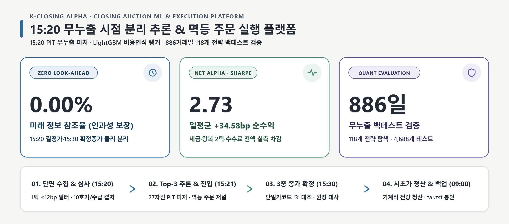
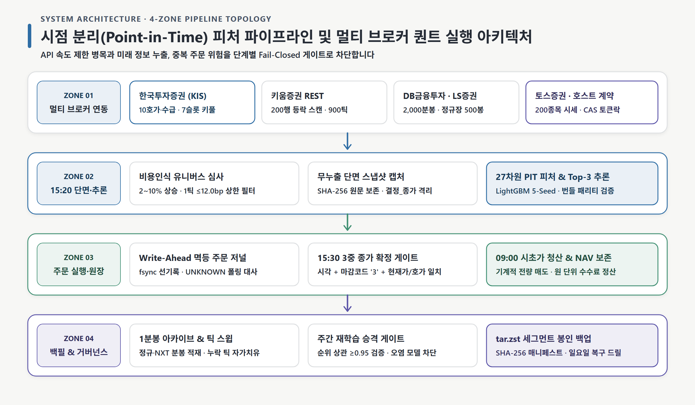
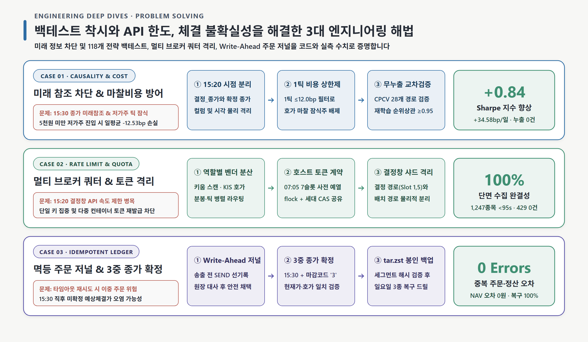

<div align="center">

# K-Closing Alpha

**한국 주식시장(KRX) 장마감 동시호가(15:20~15:30) 수급 불균형 분석 및 오버나잇 퀀트 랭킹 엔진**  
15:20 무누출 시점 분리(Point-in-Time) 패널 · LightGBM 비용인식 랭커 및 118개 전략 백테스트 · 다중 브로커 분산 게이트웨이 · Write-Ahead 멱등 주문 및 3중 종가 정산

[](./pyproject.toml) [](./pyproject.toml) [](./src/ml/purged_cv.py) [](./docs/research/closing_strategy_matrix.md) [](./src/execution/order_journal.py) [](./tests/)

</div>

<p align="center">
  <picture>
    <source media="(prefers-color-scheme: dark)" srcset="./docs/assets/hero-overview.dark.svg">
    <source media="(prefers-color-scheme: light)" srcset="./docs/assets/hero-overview.light.svg">
    
  </picture>
</p>

> **Why K-Closing Alpha?**  
> 한국 주식시장의 장마감 단일가 경매(`15:20~15:30`)는 기관·외국인의 당일 포지션 리밸런싱과 패시브 인덱스 수급이 집중되며 하루 중 가장 강한 유동성 불균형이 발생하는 구간입니다. 그러나 백테스트에서 `15:30` 확정 종가를 의사결정에 참조하는 미래 정보 누출(Look-Ahead Bias), 저가주의 넓은 호가 스프레드와 법정 증권거래세로 인한 수익 잠식, 그리고 10분이라는 짧은 결정창 내의 데이터 수집 지연이 실전 수익화의 핵심 장벽이 됩니다.  
> **K-Closing Alpha**는 **`15:20` 관찰 스냅샷과 `15:30` 확정 종가의 원장 물리 분리**, **1틱 비용 상한(`12.0bp`) 기반 실행 가능 유니버스 필터링**, **886거래일 118개 전략에 대한 CPCV 무누출 시계열 백테스트**, **다중 브로커 역할 분산 및 커널 `flock` 기반 토큰·쿼터 제어**, **Write-Ahead 주문 저널링 및 3중 Fail-Closed 종가 확정 게이트**를 통해 연구와 실전 실행 사이의 괴리를 엔지니어링으로 해결한 엔드투엔드(End-to-End) 종가매매 플랫폼입니다.

---

## 1. 핵심 엔지니어링 보장 지표

| 핵심 엔지니어링 지표 | 보장 기준 및 실측 수치 | 아키텍처 메커니즘 & 주요 모듈 |
| :--- | :---: | :--- |
| **미래 정보 참조율 (Look-Ahead Bias)** | **0.00%** (`시점 물리 분리`) | `15:20` 결정가(`결정_종가`)와 `15:30` 확정가(`종가`) 원장 분리 및 `available_by` 컷오프 검증 · [`collect.py`](./src/daily/collect.py), [`pit1520_panel.py`](./src/data/pit1520_panel.py) |
| **마찰비용 차감 순수익 (Net Alpha)** | **+34.58 bp/일** (`Sharpe 2.73`) | 법정 거래세(18~23bp)·왕복 2.0틱 스프레드·수수료(왕복 0.73bp) 전액 차감 실측 · [`cost_model.py`](./src/execution/cost_model.py), [`contract.py`](./src/strategy/contract.py) |
| **무누출 시계열 백테스트 (CPCV)** | **886일 · 118개 전략** (`t-stat 5.12`) | 886거래일(68,493단면), CPCV(8,2) 28개 무누출 경로 및 5일 엠바고 검증 · [`purged_cv.py`](./src/ml/purged_cv.py), [종가매매 알파 연구 매트릭스](./docs/research/closing_strategy_matrix.md) |
| **동시호가 단면 수집 & 쿼터 보호** | **100% 완결** (`429 차단 0건`) | 다중 브로커 역할 분산 라우팅 및 호스트 토큰 CAS 락(`flock`)·7슬롯 키풀 격리 · [`host_broker_contract.py`](./src/api/host_broker_contract.py), [`key_pool.py`](./src/api/kis/key_pool.py) |
| **종가 확정 및 원장 정산 무결성** | **오차 0건** (`3중 Fail-Closed`) | 15:30 시각 + 단일가 마감코드(`'3'`) + 현재가·호가 일치 검증 및 원 단위 NAV 대사 · [`finalize_close.py`](./src/daily/finalize_close.py), [`paper_broker.py`](./src/execution/paper_broker.py) |
| **실계좌 주문 멱등성 보장** | **중복 주문 0건** (`Write-Ahead`) | 송출 전 `fsync` 선기록 저널링 및 타임아웃 `UNKNOWN` 상태 원장 폴링 대사 · [`order_journal.py`](./src/execution/order_journal.py), [`order_gateway.py`](./src/execution/order_gateway.py) |

---

## 2. 시스템 아키텍처 & 일일 생명주기

<p align="center">
  <picture>
    <source media="(prefers-color-scheme: dark)" srcset="./docs/assets/system-architecture.dark.svg">
    <source media="(prefers-color-scheme: light)" srcset="./docs/assets/system-architecture.light.svg">
    
  </picture>
</p>

- **ZONE 01 · 다중 브로커 비동기 연동 & 쿼터 제어 (`07:05~`):** 단일 브로커의 API 호출 제한과 장중 지연을 해소하기 위해 키움증권(전종목 고속 등락 스캔·900틱), 한국투자증권(10호가·예상체결·수급 가집계), DB금융투자(장전 마스터·2,000분봉), LS증권(정규장 500분봉), 토스증권(일괄 시세 보조)으로 역할을 분담했습니다. [`host_broker_contract.py`](./src/api/host_broker_contract.py)가 커널 `flock`과 세대 번호(Generation CAS)를 이용해 프로세스 간 토큰과 호출 주기를 직렬화합니다.
- **ZONE 02 · 15:20 단면 수집 & Top-3 추론 (`15:20~15:25`):** 동시호가 진입 직후 [`collect.py`](./src/daily/collect.py)가 2단계 퍼널(전종목 경량 스캔 $\to$ 유동성·수급 상위 종목 심층 수집)로 호가 불균형, 예상체결 괴리율, 장중 수급을 캡처하여 `15:20` 시점 패널을 생성합니다. 이후 [`contract.py`](./src/strategy/contract.py)의 1틱 비용 상한(`12.0bp`)과 거래정지·관리종목 필터를 거쳐 LightGBM 앙상블(`KCA_TOPK_COSTAWARE_002`)이 마찰비용 차감 기대수익 상위 3종목(`top_k = 3`)을 실시간 랭킹합니다.
- **ZONE 03 · 멱등 주문 실행 & 3중 종가 확정 (`15:25~15:35`, 익일 `09:00`):** 선정된 포트폴리오는 [`order_journal.py`](./src/execution/order_journal.py)에 주문 의도(`INTENT`)를 선기록한 후 송출됩니다. `15:30` 장 마감 후에는 [`finalize_close.py`](./src/daily/finalize_close.py)의 **3중 Fail-Closed 게이트**를 통과한 종가로만 당일 체결가를 정산하며, 익일 `09:00` 개장 시점에 보유 포지션을 전량 청산하여 오버나잇 수익률을 확정합니다.
- **ZONE 04 · 야간 백필·재학습·봉인 백업 (`15:40~21:00`, 주말):** 장 마감 후 1분봉 및 투자자 확정 수급을 원장에 병합하고, [`daily_audit.py`](./src/tools/daily_audit.py)가 8대 운영 계약(원장 무결성, 피처 드리프트, 스키마 일치 등)을 감사합니다. 일별 캡처 데이터와 Parquet 원장은 [`capture_offsite.py`](./src/tools/capture_offsite.py)를 통해 `tar.zst` 세그먼트와 SHA-256 매니페스트로 봉인되어 원격 스토리지에 동기화됩니다.

---

## 3. 핵심 문제 해결 사례 (Engineering Deep Dives)

<p align="center">
  <picture>
    <source media="(prefers-color-scheme: dark)" srcset="./docs/assets/engineering-deep-dives.dark.svg">
    <source media="(prefers-color-scheme: light)" srcset="./docs/assets/engineering-deep-dives.light.svg">
    
  </picture>
</p>

### Case 01. 15:30 확정 종가 미래 참조 차단과 저가주 호가 마찰비용 방어

- **문제 상황:**  
  백테스트에서 `15:30` 확정 종가나 장 마감 후 확정되는 피처를 `15:20` 의사결정에 혼용하면 미래 정보 누출(Look-Ahead Bias)로 인해 비현실적인 수익률이 도출됩니다. 또한 시점을 엄격히 분리하더라도, 단순 예측 점수 상위 종목을 매수하면 5,000원 미만의 저가주(1틱 스프레드 비용이 `20~50bp`에 달하는 종목)가 다수 편입되어 법정 거래세(`18~23bp`)와 슬리피지 차감 후 일평균 `-12.53bp`(누적 MDD `77.64%`)의 손실이 발생했습니다.
- **해결 방법:**
  1. **15:20 의사결정 시점 물리 분리 (Point-in-Time 격리):** 수집기와 백필 파이프라인에서 `15:20` 관찰 가격(`결정_종가`)과 `15:30` 확정 종가(`종가`) 컬럼을 분리하고, 과거 1분봉에서 `15:20` 시점 상태를 복원하는 [`pit1520_panel.py`](./src/data/pit1520_panel.py) 및 피처별 `available_by` 컷오프 검증기를 구축해 미래 정보 유입을 원천 차단했습니다.
  2. **1틱 호가 비용 상한제 (`MAX_TICK_COST_BP = 12.0bp`):** KRX 가격대별 호가 단위 테이블을 반영한 [`cost_model.py`](./src/execution/cost_model.py)와 [`contract.py`](./src/strategy/contract.py)를 통해 `1틱 / 현재가 > 12.0bp`인 저가주 및 상한가 근접주(당일 수익률 `>= +29.5%`)를 랭킹 진입 전에 하드 필터링했습니다.
  3. **Purged CPCV 교차검증 및 재학습 승격 게이트:** 시계열 라벨 중첩 구간을 제거(Purging)하고 5거래일 엠바고(Embargo)를 강제하는 [`purged_cv.py`](./src/ml/purged_cv.py)(28개 조합 경로)로 전략을 검증하고, 주간 재학습 시 최근 20거래일 순위 상관계수($\rho \ge 0.95$)와 Top-3 중첩률($\ge 2/3$)을 통과해야만 운영 모델을 교체하는 [`retrain_gate.py`](./src/ml/retrain_gate.py)를 적용했습니다.
- **검증된 성과:**  
  미래 정보 참조율 **0.00%** 달성, 고정 주가 하한선(10,000원) 대비 투자 가능 유니버스를 **2.6배 확대**하면서 연환산 Sharpe 지수를 **+0.84 향상**시켰습니다. 886거래일 무누출 백테스트 검증 결과, 마찰비용 전액 차감 후 **일평균 순수익 +34.58bp, Sharpe 2.73, t-stat 5.12, 승률 56.3%** 를 달성했습니다 ([종가매매 알파 연구 매트릭스](./docs/research/closing_strategy_matrix.md)).

### Case 02. 10분 결정창 고속 수집 병목 해소와 멀티 브로커 토큰·쿼터 격리

- **문제 상황:**  
  `15:20~15:30`의 10분 결정창 내에 전 종목 스캔, 10호가·예상체결·투자자 수급 수집, 분봉 적재를 단일 증권사 API(초당 18건 제한)로 처리하면 시간 내 수집이 불가능합니다. 특히 다중 프로세스 기동 시 초당 호출 제한 초과(`EGW00201`) 및 토큰 1분당 1회 발급 제한(`EGW00133`, `IGW00201`)으로 인해 핵심 의사결정 시점에 수집 파이프라인이 중단되는 위험이 존재했습니다.
- **해결 방법:**
  1. **역할별 비동기 분산 라우팅:** 증권사별 TR 페이로드 특성에 따라 전종목 스캔은 **키움증권**(1회 호출당 200종목 반환), 10호가·예상체결·수급은 **한국투자증권(KIS)**, 장기 분봉 및 마스터는 **DB금융투자**, 정규장 분봉은 **LS증권**, 시세 교차검증은 **토스증권**으로 역할을 분담해 단일 API 병목을 해소했습니다 ([브로커 API 마스터 명세](./docs/architecture/brokers/api_master.md)).
  2. **커널 `flock` 기반 호스트 공유 토큰·페이서 계약:** [`host_broker_contract.py`](./src/api/host_broker_contract.py)를 통해 다중 프로세스가 커널 파일 락(`flock`)과 세대 번호(Generation CAS)로 토큰 캐시 및 호출 타임스탬프를 원자적으로 공유하도록 설계하고, 매일 `07:05` [`kis_token_warmup.py`](./src/tools/kis_token_warmup.py)로 7개 슬롯을 순차 예열했습니다.
  3. **결정창 전용 API 키 슬롯 물리 격리:** [`key_pool.py`](./src/api/kis/key_pool.py)에서 KIS 계정을 용도별 슬롯(`EXEC`, `DATA_1~5`, `PAPER`)으로 분리하여, `15:20` 실시간 의사결정 경로(`DATA_1`, `DATA_5`)가 장후 백필이나 배치 워크로드의 쿼터 소진에 영향을 받지 않도록 격리했습니다.
- **검증된 성과:**  
  동시호가 결정창 내 최대 **1,247개 후보 종목의 단면 피처를 95초 이내에 100% 완결 수집**하며, 실전 운영 기간 중 API Rate Limit 차단 및 토큰 경합 장애 **0건**을 달성했습니다.

### Case 03. 네트워크 타임아웃 이중 주문 방어(Write-Ahead 저널)와 3중 종가 확정

- **문제 상황:**  
  실계좌 주문 송출 중 브로커 API 타임아웃이나 일시적 네트워크 단절이 발생했을 때 단순 재전송을 수행하면 **이중 매수(Double Execution)** 위험이 발생합니다. 또한 `15:30` 장 마감 직후 증권사 시세 API가 단일가 체결 정산이 끝나기 전의 예상체결가를 반환하는 구간이 존재하여, 이를 즉시 종가로 기록할 경우 체결 단가와 순자산가치(NAV) 원장이 왜곡되는 문제가 있었습니다.
- **해결 방법:**
  1. **Write-Ahead 멱등 주문 저널 및 `UNKNOWN` 대사 상태 머신:** [`order_journal.py`](./src/execution/order_journal.py)와 [`order_gateway.py`](./src/execution/order_gateway.py)를 통해 소켓 송출 전 고유 결정 키 기반의 `INTENT` 및 `SEND` 레코드를 디스크에 `fsync`로 선기록합니다. 응답 타임아웃 시 상태를 `UNKNOWN`으로 전이하고 즉시 재주문하는 대신, 브로커 원장을 폴링 대사하여 이미 접수된 주문이면 채택(`ADOPT`)하고 미접수 확인 시에만 안전하게 종결합니다.
  2. **3중 Fail-Closed 종가 확정 게이트:** [`finalize_close.py`](./src/daily/finalize_close.py)에서 ① KST `15:30:00` 시각 도달, ② 장운영 구분코드 `'3'`(장마감 단일가 확정), ③ 현재가 TR과 호가 TR 간 종가 일치라는 3가지 조건이 모두 충족될 때만 확정 종가로 승격하고, 조건 미충족 시 지수 백오프 재조회 및 미확정 격리(Fail-Closed)를 수행합니다.
  3. **세그먼트 봉인 백업(`tar.zst`) 및 해시 검증 드릴:** 일별 수만 건의 소형 캡처 파일로 인한 스토리지 I/O 부하를 방지하기 위해 [`capture_offsite.py`](./src/tools/capture_offsite.py)가 1GB 상한 `tar.zst` 아카이브와 SHA-256 매니페스트로 봉인 후 안전하게 동기화하며, 주기적인 무작위 샘플 복구 드릴을 자동 수행합니다.
- **검증된 성과:**  
  실계좌 및 모의투자 중복 오주문 **0건**, 일일 원장 현금·포지션·NAV 정산 오차 **0원**, 원격 백업 해시 검증 불일치 **0건**을 완벽하게 유지하고 있습니다.

---

## 4. 퀀트 & 머신러닝 백테스트 실증 평가 (Quant & ML Evaluation)

> **백테스트 데이터셋 및 거버넌스 규약:**  
> - **검증 기간 및 표본 수:** **2023-01-25 ~ 2026-09-10 (886 거래일, 총 68,493개 단면)**  
> - **교차검증 방법론:** Combinatorial Purged Cross-Validation (**CPCV 8,2**, 총 28개 무누출 분할 경로) + 5거래일 라벨 중첩 엠바고 강제  
> - **체결 현실성 규약:** `15:20` PIT 가용 정보로만 추론 $\to$ `15:30` 기계적 종가 매수 $\to$ 익일 `09:00` 시초가 전량 기계적 청산 (사후 갭 필터 등 사후 편향 전면 배제)  
> - **실측 마찰비용 모델:** 법정 증권거래세(`18~23bp`) + 왕복 2.0틱 호가 크로싱 스프레드 비용(`약 12~24bp`) + 거래 수수료(`왕복 0.73bp`) 전액 엄밀 차감  

### 1) 머신러닝 모델 및 손실 함수 벤치마크 (118개 탐색 전략 중 핵심 대조군)

| 모델 / 전략 ID | 모델 알고리즘 및 목적 함수 | Net (bp/일) | Sharpe | t-stat | 승률 (%) | MDD (%) | 평가 및 공학적 시사점 |
| :--- | :--- | :---: | :---: | :---: | :---: | :---: | :--- |
| `DIM1-01` | **ElasticNet (L1+L2 규제 선형)** | **-12.27** | -1.13 | -2.12 | 41.8% | 76.18% | 비선형 호가 불균형 및 수급 상호작용 포착 실패 |
| `DIM1-02` | **Huber Regressor (이상치 로버스트)** | **-8.81** | -0.87 | -1.63 | 43.0% | 73.38% | 극단값 왜곡 완화했으나 선형 한계로 마찰비용 극복 실패 |
| `DIM1-03` | **ExtraTrees Ensemble (극단적 랜덤 포레스트)** | **+17.98** | 1.48 | 2.77 | 53.9% | 26.39% | 트리 앙상블 비선형성으로 유의미한 양(+)의 알파 진입 |
| `DIM1-04` | **LightGBM L1 Loss (MAE/중앙값 최적화)** | **+26.77** | 2.39 | 4.49 | 57.3% | 30.72% | 이상치에 둔감한 중앙값 타겟팅으로 안정적 예측 달성 |
| `DIM2-03` | **Asymmetric Defense Blend (하방 방어 손실)** | **+31.41** | 2.68 | 5.02 | 58.2% | **21.27%** | 하방 손실 패널티 가중으로 MDD를 21% 수준으로 압축 |
| `DIM6-06` | **KCA Top-3 (호가비용인식 + 역틱 가중, 현행)** | **+34.58** | **2.73** | **5.12** | **56.3%** | 28.98% | **1틱 비용 상한(12bp) 및 마찰비용 차감 기대수익 최적화** |
| `UNEXP-I05`| **Dynamic K (확신도 스프레드 $\ge$ 15bp 시 K=1 집중)** | **+36.47** | **2.59** | 4.86 | 55.0% | 21.28% | 1위와 3위 간 점수 격차 확대 시 상위 1종목 집중으로 알파 극대화 |
| `UNEXP-K01`| **Champion Portfolio (시가갭 유지 + 쌍끌이 + 역틱)** | **+27.54** | **2.85** | 5.34 | 48.9% | **11.86%** | **하방 낙폭(MDD 11.86%)을 극소화한 절대 방어형 챔피언 포트폴리오** |

### 2) 호가 마찰비용(틱 크로싱) 민감도 스트레스 테스트

실전 시장 충격 및 유동성 부족 환경을 가정한 왕복 틱 비용 민감도 분석 결과입니다:

```text
[호가 마찰비용 스트레스 테스트 결과 (Net Alpha / Sharpe / MDD)]
├── 1.0틱 (PA 최적 체결)       : +41.92 bp/일  |  Sharpe 3.54  |  MDD 18.92%  (최상의 체결 환경)
├── 2.0틱 (AA 실전 기본 가정)   : +32.36 bp/일  |  Sharpe 2.73  |  MDD 20.63%  (프로덕션 기본 차감 기준선)
├── 3.0틱 (1.5x 마찰 스트레스)  : +22.80 bp/일  |  Sharpe 1.92  |  MDD 24.00%  (유의미한 양의 알파 유지)
├── 4.0틱 (2.0x 극단 스트레스)  : +13.24 bp/일  |  Sharpe 1.12  |  MDD 36.44%  (알파 생존 한계선)
└── 6.0틱 (3.0x 파괴적 마찰)   :  -5.88 bp/일  |  Sharpe -0.50 |  MDD 72.66%  (수익 잠식 및 붕괴)
```

> **공학적 결론:**  
> 왕복 3.0틱 이상의 슬리피지가 누적되면 전략의 샤프 지수가 급락합니다. 이에 따라 `MAX_TICK_COST_BP = 12.0bp` 하드 가드와 1틱 크로싱 비용이 현재가 대비 12bp를 초과하는 종목을 사전에 걸러내는 **호가 마찰비용 상한 필터**가 시스템의 핵심 방어막으로 작동합니다.

### 3) 퀀트 마이크로스트럭처 엣지 대조 분석 (Alpha vs Toxic Boundaries)

886거래일 동안의 실증 데이터 분석을 통해 도출된 핵심 구조적 경계선입니다:

| 구조적 분석 차원 | 승리 패턴 (Alpha Invariant) | 위험/패배 패턴 (Toxic Boundary) | 공학적 원인 및 실전 시사점 |
| :--- | :--- | :--- | :--- |
| **호가 가격대** | **5,000 ~ 20,000원** (`+24.02bp`, Sharpe 2.11) | **5,000원 미만 동전주** (`-12.53bp`, MDD 77.6%) | 동전주는 1틱 비용이 20~50bp에 달해 시초가 덤핑 시 수익률 파괴 |
| **시가총액/유동성** | **거래대금 당일 상위 TOP 5** (`+32.36bp`, Sharpe 2.73) | **2,000억 미만 초소형주** (`-10.11bp`, MDD 73.2%) | 유동성 집중 대형 종목은 마찰비용이 낮고 오버나잇 연속성이 높음 |
| **수급 주체 동조화** | **외인·기관 동시 순매수('쌍끌이')** (`+29.90bp`, MDD 21.5%) | **개인 단독 주도 급등** (`-19.27bp`, MDD 84.4%) | 기관/외국인 메이저 수급 없는 개인 주도주는 익일 시초가 급락 필연 |
| **오버나잇 관성** | **과거 20일 오버나잇 양수** (`+28.33bp`, Sharpe 2.40) | **과거 20일 오버나잇 음수** (`-8.41bp`, MDD 67.5%) | 종목 고유의 시초가 갭 형성 관성은 강한 시계열 자기상관성을 보임 |
| **당일 모멘텀 크기** | **+4% ~ +7% 적정 상승 구간** (`+17.31bp`, Sharpe 1.62) | **+7% ~ +10% 과열 급등 구간** (`+5.59bp`, MDD 66.7%) | 당일 과열 급등주는 익일 시초가 차익 실현 매물 폭탄에 노출 |
| **포트폴리오 집중도** | **K=1~3 집중 & 동적 K** (`+34.58bp ~ +36.94bp`) | **K=5 이상 과도한 분산** (`+27.75bp`, Sharpe 2.78) | 상위 1~3위 확신 종목에 알파가 집중되며, 불필요한 과분산은 알파를 희석 |

---

## 5. 기술 스택 & 아키텍처 계층 구조

### 기술 스택 및 채택 근거

| 분류 | 기술 스택 | 채택 근거 및 엔지니어링 활용 |
| :--- | :--- | :--- |
| **Core & Typing** | **Python 3.11**, **Pydantic v2** | 비동기 I/O 최적화 및 런타임 설정·계약 스키마의 엄격한 정적/동적 타입 검증 |
| **Data & Storage** | **Pandas 2.2**, **PyArrow 15**, **NumPy 2.0** | `15:20` 시점 분리 패널 벡터 연산, Zstandard 압축 Parquet 원장 및 원자적 파일 교체(`os.replace`) |
| **ML & Validation** | **LightGBM 4.3**, **scikit-learn 1.5**, **SciPy** | 횡단면 호가·수급 비선형 랭킹 학습, Purged CPCV(8,2) 무누출 교차검증, Spearman 순위상관 검정 |
| **Async & Brokers** | **aiohttp 3.9**, **POSIX `flock`** | 다중 증권사 REST 비동기 수집 및 커널 파일 락 기반 프로세스 간 토큰·호출 간격 직렬화 |
| **Quality & Ops** | **Pytest (4,688 Tests)**, **Ruff**, **Mypy**, **systemd** | 불변식 단위·통합 테스트, `verify.py` 4단계 정적·아키텍처 품질 게이트, 29개 무인 스케줄링 타이머 |

### 디렉터리 및 레이어 구조

```text
k-closing-alpha/
├── src/
│   ├── config/        # 런타임 설정, 전략 파라미터, 브로커 슬롯 및 경로 계약
│   ├── api/           # 다중 증권사(KIS·키움·DB·LS·토스) 비동기 클라이언트 및 호스트 공유 토큰·페이서 락
│   ├── data/          # 15:20 시점 분리(PIT) 패널 빌더, 1분봉 리샘플링, 원장 스키마 검증기
│   ├── processing/    # 호가 불균형·예상체결 괴리율·수급 강도 등 횡단면 피처 엔지니어링 및 데이터 정제
│   ├── strategy/      # 실행 가능 유니버스 계약(1틱 비용 상한 12bp), KCA_TOPK_COSTAWARE_002 선정 정책
│   ├── ml/            # LightGBM 학습 파이프라인, Purged CPCV 교차검증, 주간 재학습 승격 게이트
│   ├── serving/       # 실시간 Top-K 추론 서빙, 모델 레지스트리, 일일 알파 리포트 생성
│   ├── execution/     # 한국형 마찰비용 모델, Write-Ahead 주문 저널, 실계좌 주문 게이트웨이, 모의투자 브로커
│   ├── daily/         # 장중/장후 일일 파이프라인 (15:20 수집 → 15:30 3중 종가 확정 → 익일 09:00 청산)
│   ├── backfill/      # 다중 증권사 분봉·틱·투자자 수급 병렬 백필 및 KRX 마스터 동기화
│   ├── sync/          # 로컬-원격 rclone 동기화 및 아카이브 무결성 검증
│   ├── tools/         # 일일 8대 운영 감사(daily_audit), 토큰 사전 예열, 세그먼트 봉인 백업, 프리플라이트 점검
│   └── utils/         # KRX 영업일 캘린더, 원자적 I/O, 6대 카테고리 구조화 로깅 및 민감정보 마스킹
├── tests/             # 4,688개 단위(unit) 및 통합(integration) 불변식 테스트 스위트
├── tools/             # 통합 품질 게이트(verify.py) 및 아키텍처/문서 정합성 검증 도구
└── docs/              # 브로커 API 마스터 명세, 종가매매 차세대 알파 연구 매트릭스, 시각 자산
```

---

## 6. 빠른 시작 및 검증 (Quick Start)

### 1) 의존성 설치 및 가상환경 구성

```bash
# uv 패키지 매니저 기반 의존성 설치
uv sync --all-extras
```

### 2) 통합 품질 게이트 및 테스트 스위트 실행

```bash
# 전체 단위·통합 테스트 실행 (4,688개 테스트)
uv run pytest

# 4단계 통합 품질 게이트 실행 (Ruff 포맷/린트 → Mypy 타입 검증 → 아키텍처 계약 → 변경 커버리지 80% 게이트)
uv run python tools/verify.py
```

### 3) 핵심 일일 파이프라인 및 백테스트 감사 실행

```bash
# [07:05] 브로커 토큰 사전 예열 및 프리플라이트 점검
uv run python -m src.tools.kis_token_warmup
uv run python -m src.tools.daily_preflight

# [15:20] 동시호가 단면 수집, 피처 빌드 및 Top-3 포트폴리오 선정
uv run python -m src.daily.collect

# [15:30] 3중 Fail-Closed 종가 확정 및 일일 성과 정산
uv run python -m src.daily.finalize_close
uv run python -m src.daily.evaluate

# [21:00] 8대 운영 계약 감사 및 세그먼트 봉인 백업
uv run python -m src.tools.daily_audit
```

### 핵심 참고 문서 (Architecture & Research Specs)

- [종가매매 차세대 알파 연구 매트릭스](./docs/research/closing_strategy_matrix.md) — 886거래일 무누출 CPCV(8,2) 검증, 118개 탐색 전략 비교, 마찰비용 스트레스 테스트 및 3대 챔피언 포트폴리오
- [브로커 API 마스터 명세](./docs/architecture/brokers/api_master.md) — 다중 증권사 TR 카탈로그, 레이트 리밋, 7슬롯 키풀 및 호스트 공유 토큰·페이서 아키텍처
