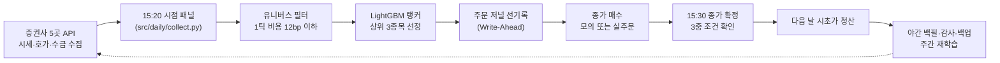

# K-Closing Alpha

**국내 주식의 장마감 동시호가 구간(15:20~15:30) 정보만으로 종목을 고르고, 종가에 사서 다음 날 시초가에 파는 종가매매 전략을 연구하고 자동 실행하는 프로젝트**

[](./pyproject.toml) [](./src/ml/costaware_topk.py) [-0D9488?style=flat-square)](./src/ml/robust_eval.py) [](./deploy/systemd) [](./.github/workflows/deploy.yml)

> [!NOTE]
> 이 README의 성과 수치는 모두 **과거 데이터 백테스트** 결과이며 실계좌 수익을 나타내지 않습니다.

## 🧭 개요

한국 시장은 15:20부터 15:30까지 종가를 정하는 동시호가가 열립니다. 이 10분 동안 호가와 예상체결가가 크게 움직이고, 15:30에 확정된 종가에 주문이 체결됩니다. 이 프로젝트는 다음 전략을 코드로 만들었습니다.

1. 15:20 시점에 볼 수 있는 정보만으로 종목 점수를 매깁니다.
2. 점수 상위 3종목을 15:30 종가에 사고, 다음 날 09:00 시초가에 전량 팝니다(백테스트 규칙).
3. 거래세, 수수료, 호가 간격(틱) 비용을 모두 뺀 순수익으로 평가합니다.

이 과정에서 풀어야 했던 문제는 세 가지였습니다.

- **미래 정보가 섞이면 수익이 부풀려집니다.** 15:30 종가를 15:20 판단에 쓰면 백테스트가 비현실적으로 좋아집니다.
- **호가 간격이 큰 저가주는 비용이 큽니다.** 1틱 비용이 수익을 넘는 종목을 거릅니다.
- **10분 안에 데이터를 모으고 주문을 내야 합니다.** 증권사 API 호출 제한을 지키면서 중복 주문 없이 실행해야 합니다.

## 🏗️ 시스템 구성

하루 흐름은 아래와 같습니다.



- 수집(`kca-collect`)은 15:20, 예측(`kca-predict`)은 15:21, 종가 확정(`kca-finalize-close`)은 15:30:30에 실행됩니다(systemd 타이머 설정 기준, [`deploy/systemd`](./deploy/systemd)). 모의 매매(`paper_trade`)와 실주문(`order_session`)은 서비스가 분리되어 있습니다.
- 증권사별 역할을 나눴습니다: 키움(전종목 스캔), 한국투자증권(호가·예상체결·수급), DB금융투자(장전 마스터, 분봉), LS증권(정규장 분봉), 토스증권(시세 보조). 호출 제한은 [`api_master.md`](./docs/architecture/brokers/api_master.md)에 정리했습니다.
- 운영은 systemd 타이머 29개로 자동화했고, GitHub Actions가 테스트 후 ARM64 도커 이미지를 빌드해 서버에 배포합니다([`deploy.yml`](./.github/workflows/deploy.yml)).

## 🔧 핵심 설계 결정

각 결정을 **문제 → 분석(대안 비교) → 선택 → 결과** 순서로 정리했습니다.

### 🕒 1. 15:20 판단 시점과 15:30 확정 종가를 분리

- **문제:** 15:30에 확정되는 종가나 그 이후에 알 수 있는 값이 피처에 들어가면 백테스트가 실제로는 불가능한 수익을 보여 줍니다.
- **분석:** 전체 기간 데이터를 한꺼번에 쓰는 방법은 단순하지만 누출을 코드로 막지 못합니다. 데이터를 처음부터 시점별로 따로 저장하는 쪽이 검증하기 쉽다고 봤습니다.
- **선택:** 수집 시점의 가격(`결정_종가`)과 확정 종가(`종가`)를 다른 컬럼으로 저장합니다. 과거 구간은 1분봉에서 15:20 상태를 복원해 같은 형태로 만듭니다([`pit1520_panel.py`](./src/data/pit1520_panel.py)). 작업 규칙에도 "관측 불가능한 가격으로 체결 가정 금지"를 명시했습니다([`AGENTS.md`](./AGENTS.md)).
- ✅ **결과:** 연구 문서 기준으로 모든 백테스트가 15:20 시점 정보만으로 판단하고 15:30 종가 매수, 다음 날 09:00 시초가 청산 규칙을 따릅니다.

### 💸 2. 틱 비용 상한 12bp 필터

- **문제:** 점수 상위 종목을 그대로 사면 호가 간격이 큰 저가주가 많이 들어옵니다. 1틱이 가격의 20~50bp(1bp = 0.01%)인 종목은 세금과 슬리피지를 빼면 손실이 납니다.
- **분석:** 상한을 6, 9, 12, 15bp 및 상한 없음으로 바꿔 비교했습니다. 문서 기재 기준으로 12bp는 후보 종목 수를 7.5bp 대비 2.6배로 늘리면서 Sharpe도 높았습니다(15bp 상한은 Sharpe 2.88로 더 높지만 매매가 이뤄진 날이 83.3%로, 12bp의 99.7%보다 적습니다).
- **선택:** 가격대별 호가 단위 표를 코드에 넣고, `1틱 / 현재가 > 12bp`인 종목은 순위를 매기기 전에 제외합니다([`cost_model.py`](./src/execution/cost_model.py), [`contract.py`](./src/strategy/contract.py)). 상한가 근처 종목 처리도 같은 계약 안에 있습니다.
- ✅ **결과:** 5,000원 미만 종목만 사면 일평균 -12.53bp, 5,000~20,000원 구간은 +24.02bp였습니다(백테스트, 연구 문서 4절). 세금은 날짜별 세율표로 계산하고, 수수료는 제가 적용받는 증권사 우대율(왕복 약 0.73bp)을 코드에 반영했습니다.

### 🧪 3. 시계열 교차검증과 모델 교체 기준

- **문제:** 라벨 기간이 겹치는 데이터를 무작위로 나누면 학습과 평가가 섞입니다. 118개 전략을 비교하다 보면 우연히 좋은 전략을 고를 위험도 있습니다.
- **분석:** 단순 시간 분할은 평가 경로가 한 개뿐이라 한 번의 운에 좌우됩니다. 데이터를 8구간으로 나눠 2구간을 시험용으로 뽑는 조합 방식(CPCV)은 평가 경로를 여러 개 만듭니다.
- **선택:** CPCV(8, 2)로 28개 분할(독립 경로 7개)을 만들고, 시험 구간 앞뒤 1구간씩을 학습에서 뺍니다([`robust_eval.py`](./src/ml/robust_eval.py)). 매주 재학습한 모델은 최근 20거래일 예측 순위 일치도 0.95 이상 같은 기준을 통과해야 운영 모델로 바뀝니다([`retrain_gate.py`](./src/ml/retrain_gate.py)).
- ✅ **결과:** 모델 교체가 기준 미달 시 자동으로 막히는 구조를 갖췄습니다.

### 🧱 4. 증권사 호출 제한과 토큰 충돌 방지

- **문제:** 한국투자증권 API는 초당 호출 수와 토큰 발급 횟수에 제한이 있습니다. 여러 프로세스가 동시에 뜨면 결정 시각에 제한에 걸릴 수 있습니다.
- **분석:** 프로세스마다 따로 제한하면 합계가 넘칩니다. 서버 한 대 안에서 하나의 규칙을 공유해야 했습니다.
- **선택:** 파일 잠금(`flock`)으로 토큰 캐시와 호출 간격을 프로세스 간에 공유합니다([`host_broker_contract.py`](./src/api/host_broker_contract.py)). 키는 용도별 슬롯으로 나눠 15:20 판단 경로가 장후 백필과 쿼터를 나눠 쓰지 않게 했고([`key_pool.py`](./src/api/kis/key_pool.py)), 토큰은 매일 정해진 시각에 한 번 미리 발급합니다.
- ✅ **결과:** 설계와 코드는 위와 같고 단위 테스트가 있습니다.

### 📝 5. 중복 주문을 막는 주문 저널

- **문제:** 주문 응답이 타임아웃되면 접수 여부를 알 수 없습니다. 그대로 재전송하면 이중 매수가 됩니다.
- **분석:** 재시도 횟수를 제한하는 방법은 이미 접수된 주문을 막지 못합니다. 보내기 전에 기록을 남기고, 결과가 불확실하면 증권사 원장을 조회해 맞추는 방식을 택했습니다.
- **선택:** 주문 의도(`INTENT`)와 전송(`SEND`)을 디스크에 먼저 쓰고 전송합니다. 응답이 불확실하면 `UNKNOWN` 상태로 두고, 증권사 원장에서 같은 주문을 찾으면 채택(`ADOPT`), 없을 때만 종결합니다([`order_journal.py`](./src/execution/order_journal.py), [`order_gateway.py`](./src/execution/order_gateway.py)).
- ✅ **결과:** 상태 전이와 채택 로직을 구현했고 단위 테스트가 있습니다.

### 🔒 6. 종가 확정 3중 조건

- **문제:** 15:30 직후 일부 시세 응답은 아직 예상체결가인 경우가 있어, 이를 종가로 기록하면 정산이 틀어집니다.
- **선택:** 세 조건을 모두 만족할 때만 종가로 인정합니다: 시각이 확정 가능 시각 이후, 장운영 구분코드가 장마감 확정값, 현재가 조회와 호가 조회의 가격이 같음. 하나라도 어긋나면 확정하지 않습니다([`finalize_close.py`](./src/daily/finalize_close.py)의 `is_close_confirmed`).
- ✅ **결과:** 조건 함수가 코드로 고정되어 있고 단위 테스트가 있습니다.

## 📊 결과

886거래일(2023-01-25 ~ 2026-09-10, 68,493개 종목-일 단면) 백테스트 결과입니다. 왕복 2틱 호가 비용, 매도 거래세, 수수료를 모두 뺀 값이며, 출처는 [연구 문서](./docs/research/closing_strategy_matrix.md)입니다.

| 전략 (문서 ID) | 일평균 순수익 | Sharpe | t값 | 승률 | 최대낙폭 |
| :--- | :---: | :---: | :---: | :---: | :---: |
| 현행: 틱 비용 12bp 상한 + 역틱 가중 (`DIM6-06`) | +34.58bp | 2.73 | 5.12 | 56.3% | 28.98% |
| 기준 대조군: LightGBM 상위 3 균등 가중 | +31.27bp | 2.57 | - | - | 25.03% |
| ElasticNet 선형 모델 (`DIM1-01`) | -12.27bp | -1.13 | -2.12 | 41.8% | 76.18% |
| ExtraTrees (`DIM1-03`) | +17.98bp | 1.48 | 2.77 | 53.9% | 26.39% |
| LightGBM L1 손실 (`DIM1-04`) | +26.77bp | 2.39 | 4.49 | 57.3% | 30.72% |

- 선형 모델은 비용을 넘지 못했고 트리 계열 모델부터 양의 수익이 나왔습니다.
- 개인 투자자 주도 종목(-19.27bp), 5,000원 미만 종목(-12.53bp), 최근 20일 오버나잇 수익이 음수인 종목(-8.41bp)은 손실이었습니다. 외국인과 기관이 함께 순매수한 종목은 +29.90bp였습니다.
- 왕복 비용을 1틱에서 6틱까지 올리는 민감도 시험에서는 4틱까지 양의 수익이 유지됐고 6틱에서 음수가 됐습니다(연구 문서 3절 `EDGE-24`~`28`).
- 전략 118개(핵심 35, 엣지 32, 세부 51)의 전체 표는 연구 문서에 있습니다.

테스트 함수는 `tests/`에 4,454개 있고(`def test_` 단순 집계, 파라미터화 전), CI에서 ruff, mypy, pytest를 통과해야 배포됩니다.

## ⚠️ 한계

- **실거래 성과가 아닙니다.** 위 수치는 모두 백테스트이고, 실계좌나 모의투자의 누적 손익 기록은 저장소에 없습니다.
- **다중 비교 편향 가능성.** 118개 전략 중 좋은 결과를 골랐기 때문에 실제 성과는 이보다 낮을 수 있습니다. 코드에는 보정 도구(`robust_eval.py`의 DSR 할인)가 있으나 보정 결과는 제시하지 않습니다.
- **재현 불가.** 원시 데이터(원장 Parquet)는 저장소에 포함하지 않아, 저장소만으로 백테스트를 다시 돌릴 수는 없습니다.
- **연구 문서의 불일치.** 같은 2틱 조건인데 문서의 두 표가 일평균 +34.58bp(`DIM6-06`)와 +32.36bp(`EDGE-25`)를 모두 Sharpe 2.73으로 적고 있습니다. `DIM6-06` 값을 사용했습니다.
- **비용 모델은 제 계좌 조건입니다.** 수수료율은 개인 우대율이라 다른 사람에게는 다를 수 있습니다.
- **세율 변경에 민감합니다.** 거래세는 날짜별 표([`cost_model.py`](./src/execution/cost_model.py))로 관리하며, 제도가 바뀌면 직접 갱신해야 합니다.

## 🧱 기술 스택

| 구분 | 사용 기술 |
| :--- | :--- |
| 언어 | Python 3.11 |
| 데이터 | pandas 2.2 이상, PyArrow(Parquet), NumPy 2 이상 |
| 모델·검증 | LightGBM 4.3 이상, scikit-learn 1.5 이상, SciPy, 자체 CPCV 구현 |
| 수집·API | aiohttp, requests, 증권사 5곳 REST API, `flock` 기반 공유 락 |
| 설정·계약 | pydantic v2, pydantic-settings |
| 품질 | pytest, ruff, mypy, 자체 검증 스크립트([`tools/verify.py`](./tools/verify.py)) |
| 배포·운영 | Docker(ARM64), GitHub Actions, GHCR, systemd 타이머 |

## 📂 프로젝트 구조

```text
src/
├── config/      # 환경 설정, 거래 시간·브로커 슬롯 계약
├── api/         # 증권사별 클라이언트, 공유 토큰·호출 제한
├── data/        # 15:20 시점 패널, 원장 저장소, 스키마 검증
├── strategy/    # 전략 스펙(상위 3종목, 틱 비용 상한), 유니버스 선정
├── ml/          # LightGBM 랭커, CPCV, 재학습 게이트, 연구용 스크립트
├── serving/     # 실시간 추론용 피처·모델 번들 로딩
├── execution/   # 비용 모델, 주문 저널, 주문 게이트웨이, 모의 브로커
├── daily/       # 일일 파이프라인(수집, 예측, 주문, 종가 확정, 모의 매매)
├── backfill/    # 분봉·틱·수급 백필
├── tools/       # 감사, 토큰 예열, 백업, 배포 점검
└── utils/       # 파일 락, 로깅, 민감정보 마스킹
tests/           # 단위·통합 테스트
deploy/          # systemd 서비스·타이머, 배포 스크립트
docs/            # 브로커 API 정리, 전략 연구 매트릭스
tools/verify.py  # 로컬 품질 게이트
```

## 🚀 시작하기

일일 파이프라인을 실행하려면 증권사 API 키와 서버 환경이 필요합니다. 키는 저장소에 포함되어 있지 않고 `.env`로 관리합니다. 테스트와 정적 검사는 키 없이 실행할 수 있습니다.

```bash
uv sync --all-extras

uv run pytest                       # 전체 테스트
uv run python tools/verify.py       # 린트, 타입, 테스트 품질 게이트

# 일일 파이프라인 진입점(API 키와 장중 시간대가 필요)
uv run python -m src.daily.collect
uv run python -m src.daily.predict
uv run python -m src.daily.finalize_close
```

## 🤖 개발 과정에서의 AI 활용

AI는 주로 코드 작성에 사용했고, 아이디어를 정리하거나 도메인(호가·동시호가 구조 등)을 공부하는 데에도 썼습니다. 수치와 동작은 직접 확인했습니다. 저장소의 [`AGENTS.md`](./AGENTS.md)와 `.agents/` 폴더에는 AI 도구가 따르는 작업 규칙과 검증 절차가 들어 있습니다.

## 📚 참고

- [종가매매 전략 연구 매트릭스](./docs/research/closing_strategy_matrix.md): 118개 전략의 백테스트 표
- [브로커 API 마스터 명세](./docs/architecture/brokers/api_master.md): 증권사별 TR, 호출 제한
